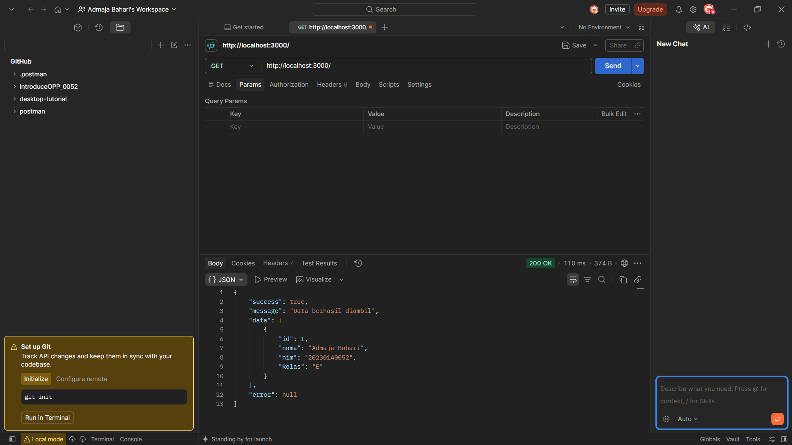
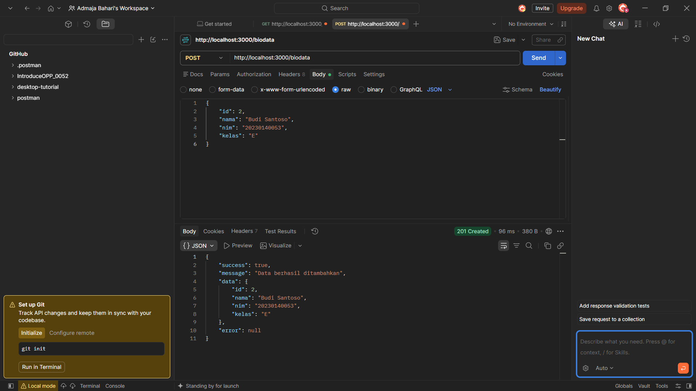
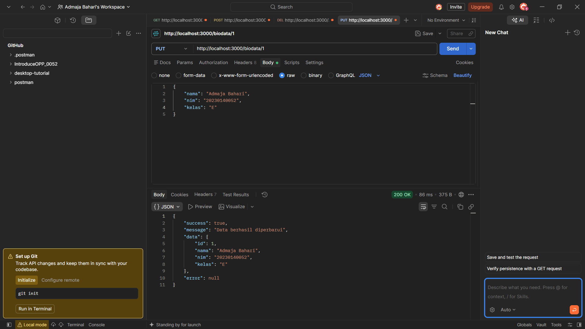
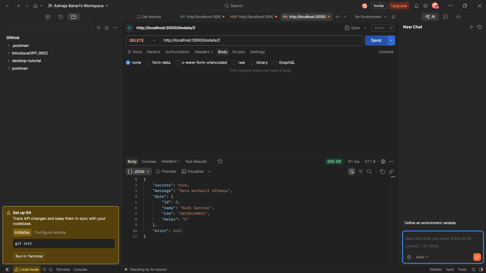

# 052_MiddlewareLayer

REST API biodata mahasiswa menggunakan Express.js, PostgreSQL, dan Joi,
dengan middleware logging, validasi, dan global error handler.

## Endpoint

| Method | Endpoint     | Fungsi              |
|--------|--------------|---------------------|
| GET    | /            | Ambil semua biodata |
| POST   | /biodata     | Tambah biodata      |
| PUT    | /biodata/:id | Ubah biodata        |
| DELETE | /biodata/:id | Hapus biodata       |

## Hasil Pengujian

### GET

### POST

### PUT

### DELETE

